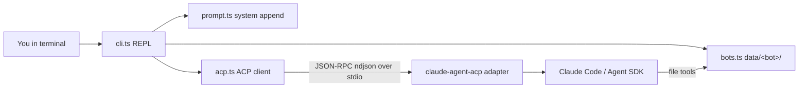
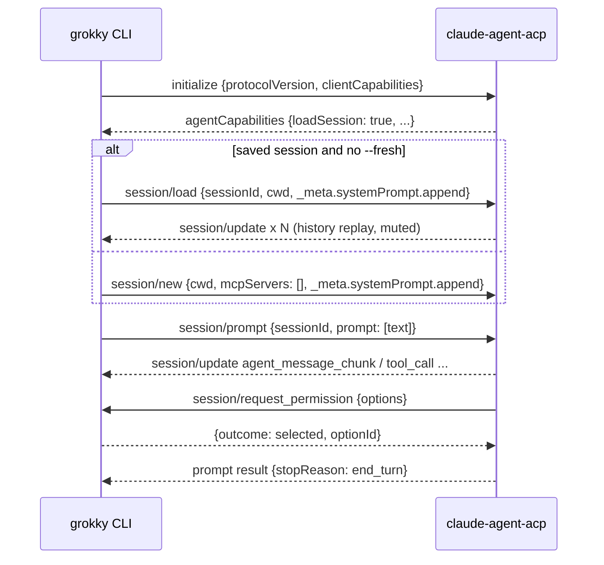

# mysimplegrokky

A minimal proof of concept of a bot host, like Grok Bot or Codync. It is a TypeScript CLI (`grokky`) that drives **Claude Code over ACP** (Agent Client Protocol). Every bot has its own instructions, its own memory file and its own long-running Claude Code session.

> Status: it type-checks, and `new`/`list` are smoke-tested. **A real chat has not been tested end to end yet.**

## Architecture



`acp.ts` is generic ACP. The only Claude-specific piece is the `spawn("npx", ["-y", "@agentclientprotocol/claude-agent-acp"])` line, plus the `_meta.systemPrompt` field.

## Per-bot data (`data/` is git-ignored)

```
data/<slug>/
  bot.json      # { name, instructions, createdAt }
  MEMORY.md     # durable memory, edited by the bot itself
  session.json  # { sessionId, updatedAt } -> resumed next chat
  workspace/    # files the bot creates
```

## One turn



## Setup

You need Node 20+ and a logged-in Claude Code (run `claude /login` once). Then:

```bash
npm install
npx tsc --noEmit   # optional type check
```

## Play

```bash
npm run grokky -- new "Kopi Bot"      # type the instructions, finish with an empty line
npm run grokky -- list
npm run grokky -- chat "Kopi Bot"     # resumes the saved session
npm run grokky -- chat "Kopi Bot" --fresh   # new session, re-reads MEMORY.md
```

In a chat, `/exit` quits. Pressing Ctrl-C during a reply cancels that turn (`[cancelled]`), and pressing it at `you>` exits.

## Experiments

1. **Memory:** tell it "I take kopi siew dai" and check `data/kopi-bot/MEMORY.md`. Then run `--fresh` and ask what you drink.
2. **Resume vs fresh:** tell it something in passing without asking it to remember. Restart without `--fresh`: does it still know? Now try `--fresh`.
3. **Deny a permission:** ask it to create a file, answer `n`, and watch how it reacts.
4. **Cancel:** ask for a long task, then press Ctrl-C. The stop reason should be `cancelled`.
5. **Swap the agent:** replace the spawn line with another ACP agent (for example Gemini CLI's ACP mode). Note that `_meta.systemPrompt` is ignored by other agents.
6. **Read `session.json`:** look the id up in `~/.claude/projects/...` to see Claude Code's own transcript.

## Learnings

- **ACP** is JSON-RPC 2.0 over stdio, one JSON message per line. The client (us) and the agent both send requests and notifications.
- **SDK v2 (`@agentclientprotocol/sdk`)** uses a builder API: `acp.client().onNotification(...).onRequest(...).connect(ndJsonStream(...))`, then `conn.agent.request(methods.agent.session.new, ...)`. Older examples using `ClientSideConnection` are the v1 API.
- **Adapter:** `@agentclientprotocol/claude-agent-acp` (it replaces `@zed-industries/claude-code-acp`) uses your existing Claude login.
- **Session lifecycle:**
  - `initialize` exchanges capabilities.
  - `session/new` starts a session.
  - `session/load` reopens one and replays its history.
  - `session/resume` reopens one without replay.
  - `session/prompt` runs one turn and returns a `stopReason` (`end_turn`, `max_tokens`, `max_turn_requests`, `refusal` or `cancelled`).
  - `session/cancel` is a notification.
- **Send the system prompt once:** `_meta.systemPrompt.append` is added to Claude Code's own preset, and only at session start. After that every turn sends only the new message, so the prompt prefix stays the same and the prompt cache stays warm. Codync does the same.
- **Session context vs durable memory:** the session remembers everything in this conversation, while `MEMORY.md` is what survives a `--fresh`. The bot writes `MEMORY.md` itself with its file tools, which works because cwd is the bot folder.
- **Memory is a snapshot:** `MEMORY.md` is read into the prompt at session start or load. Edits made mid-session reach the prompt only on the next start.
- **Permissions:** the agent asks with options (`allow_once`, `allow_always`, `reject_once` or `reject_always`, each with an `optionId`), and the client must answer before the tool runs.
- **Codync** does all of this, plus compaction handling, a rollover card, Haiku "dreaming" to tidy memory, a phone relay and several clients.
- **klex** owns its own model loop, so it can inject your message between steps. That is real mid-turn steering.
- **Why grokky can't steer:** ACP has no "add a message to a running turn" call, so a new message has to wait for the turn to finish. You could add steering in either of these ways:
  - Cancel the turn and resend it with the new message.
  - Use a Claude Code `PostToolUse` hook that reads a queued message and injects it as `additionalContext` after each tool call.

## Known limits / next steps

- A real chat hasn't been tested end to end yet.
- The memory size cap is only an instruction, and nothing enforces it.
- There's no compaction handling (Claude Code auto-compacts on its own) and no rollover.
- There's no mid-turn steering.
- No MCP servers are passed (`mcpServers: []`).
- It's a single local CLI: no daemon, routines, channels or multiple clients.
